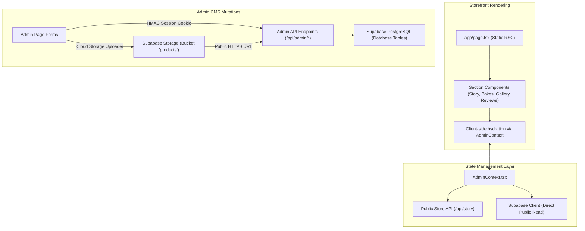

# Component Architecture & Component Map

## 1. Architectural Principles
The PlotTwist frontend leverages Next.js 16 App Router principles:
- **Server-First by Default**: The root page (`app/page.tsx`) executes as a React Server Component (RSC), delivering pure static HTML for maximum performance and zero hydration lag.
- **Client Leaf Components**: Interactive sections (carousels, filters, image uploads, dialogs) declare `'use client'` only where browser APIs or React state hooks are required.
- **Decoupled Data Layer**: Administrative state is managed through `AdminContext` and custom API endpoints, isolating storefront rendering from CMS mutation logic.

---

## 2. Complete Component Hierarchy

```
app/layout.tsx (Server Component - Font Setup & Metadata)
 └── AdminProvider (src/context/AdminContext.tsx)
      ├── app/page.tsx (React Server Component - Storefront Shell)
      │    ├── Header (src/components/Header.tsx - Client Component)
      │    │    └── MaskingTape (src/components/paper/MaskingTape.tsx)
      │    ├── PaperBackground (src/components/PaperBackground.tsx - Client Component)
      │    ├── ScrapbookHeroRedesign (src/components/ScrapbookHeroRedesign.tsx - Client Component)
      │    │    ├── MaskingTape
      │    │    └── Dynamic Stickers & CTA Badges
      │    ├── Story (src/components/sections/Story.tsx - Client Component)
      │    │    ├── MaskingTape
      │    │    └── Interactive 3D Polaroid & Badge Grid
      │    ├── Bakes (src/components/sections/Bakes.tsx - Client Component)
      │    │    └── Category Tabs & Product Cards
      │    ├── Gallery (src/components/sections/Gallery.tsx - Client Component)
      │    │    ├── Category Filter Bar
      │    │    └── PhotoCard (src/components/sections/Gallery/PhotoCard.tsx)
      │    ├── Reviews (src/components/sections/Reviews.tsx - Client Component)
      │    │    └── ReviewCarousel (src/components/sections/Reviews/ReviewCarousel.tsx)
      │    │         └── ReviewCard (src/components/sections/Reviews/ReviewCard.tsx)
      │    ├── InstagramCTA (src/components/sections/InstagramCTA.tsx - Client Component)
      │    │    └── MaskingTape & External Social Link
      │    └── Footer (src/components/sections/Footer.tsx - Client Component)
      │         └── Location Badges & Administrative Portal Trigger
      │
      └── app/admin/layout.tsx (Client Component - CMS Shell)
           ├── AdminHeader (src/components/admin/AdminHeader.tsx)
           ├── AdminSidebar (src/components/admin/AdminSidebar.tsx)
           └── Admin Pages:
                ├── /admin/login/page.tsx (Authentication Gateway)
                ├── /admin/dashboard/page.tsx (Metrics & Quick Nav)
                ├── /admin/bakes/page.tsx (Menu Catalog CRUD)
                │    ├── BakeFormModal (src/components/admin/BakeFormModal.tsx)
                │    └── DeleteConfirmDialog (src/components/admin/DeleteConfirmDialog.tsx)
                ├── /admin/story/page.tsx (Brand Narrative & Media Manager)
                ├── /admin/hero/page.tsx (Hero Artwork & Composition)
                ├── /admin/gallery/page.tsx (Photo Grid Curator)
                │    ├── GalleryFormModal (src/components/admin/GalleryFormModal.tsx)
                │    └── GalleryUploadModal (src/components/admin/GalleryUploadModal.tsx)
                ├── /admin/reviews/page.tsx (Testimonial Moderation)
                │    └── ReviewFormModal (src/components/admin/ReviewFormModal.tsx)
                └── /admin/instagram/page.tsx (Social CTA Customizer)
```

---

## 3. Detailed Component Breakdown

### A. Storefront Shell & Visual Foundations

| Component | Path | Render Boundary | Dependencies & State | Performance Role |
| :--- | :--- | :--- | :--- | :--- |
| **`RootLayout`** | `app/layout.tsx` | Server (RSC) | `next/font/google` (12 fonts), `AdminProvider` | Embeds font CSS variables directly into `<html>`; zero render-blocking requests |
| **`StorefrontPage`** | `app/page.tsx` | Server (RSC) | All primary storefront sections | Prerendered as static HTML (`○ Static`); instant first paint |
| **`Header`** | `src/components/Header.tsx` | Client | `useRouter`, `AdminContext`, rAF scroll listener, `IntersectionObserver` | Navigation, active tab tracking, mobile drawer, discreet admin login modal |
| **`PaperBackground`**| `src/components/PaperBackground.tsx` | Client | None | Hardware-accelerated 128px SVG noise pattern; zero per-frame recalculations |
| **`ScrapbookHero`** | `src/components/ScrapbookHeroRedesign.tsx` | Client | `AdminContext` (`hero`), local smooth scroll | Renders hero cheesecake image with Next.js `<Image priority>` and interactive stickers |

### B. Storefront Content Sections

| Component | Path | Render Boundary | Dynamic Content Sources | Interactions & Optimizations |
| :--- | :--- | :--- | :--- | :--- |
| **`Story`** | `src/components/sections/Story.tsx` | Client | `AdminContext` (`story`, `storyImages`) | 3D mouse tilt on main polaroid, dynamic copy (tagline, title, description), responsive mobile layout |
| **`Bakes`** | `src/components/sections/Bakes.tsx` | Client | `AdminContext` (`products`), Supabase table `products` | Category filtering (Cheesecakes, Brownies, etc.), lazy-loaded product photography |
| **`Gallery`** | `src/components/sections/Gallery.tsx` | Client | `AdminContext` (`gallery`), Supabase table `gallery_images` | Category filtering, GSAP/CSS hover animations, light-box previews |
| **`PhotoCard`** | `src/components/sections/Gallery/PhotoCard.tsx` | Client | `GalleryImage` props | Polaroid masking tape styling, responsive image loading |
| **`Reviews`** | `src/components/sections/Reviews.tsx` | Client | `AdminContext` (`reviews`), Supabase table `reviews` | Container shell for infinite testimonial marquee |
| **`ReviewCarousel`** | `src/components/sections/Reviews/ReviewCarousel.tsx`| Client | Review array | 2x minimal infinite CSS marquee; GPU-composited `-50%` transform; 33% fewer DOM nodes |
| **`ReviewCard`** | `src/components/sections/Reviews/ReviewCard.tsx` | Client | `Review` props | Customer photo loaded via `<Image fill sizes="..." />`, star rating display |
| **`InstagramCTA`** | `src/components/sections/InstagramCTA.tsx` | Client | `AdminContext` (`instagramCTA`) | Responsive display of promotional cake photo, verified handle link |
| **`Footer`** | `src/components/sections/Footer.tsx` | Client | None | Brand footer, operating hours, quick navigation links |

### C. Admin Components & Modals

| Component | Path | Responsibility | React 19 State Pattern |
| :--- | :--- | :--- | :--- |
| **`AdminProvider`** | `src/context/AdminContext.tsx` | Global state container for CMS data; handles Supabase & API synchronization | Normalized state, `useCallback` caches, optimistic updates |
| **`BakeFormModal`** | `src/components/admin/BakeFormModal.tsx` | Modal form for creating/editing product records | Render-time prop sync (`prevData` pattern); zero effect cascades |
| **`GalleryFormModal`**| `src/components/admin/GalleryFormModal.tsx`| Modal form for single gallery image metadata | Render-time prop sync (`prevData` pattern); zero effect cascades |
| **`GalleryUploadModal`**| `src/components/admin/GalleryUploadModal.tsx`| Batch image upload modal with multi-file dropzone | Direct file batching; staging list |
| **`ReviewFormModal`**| `src/components/admin/ReviewFormModal.tsx`| Modal form for customer review creation/editing | Render-time prop sync (`prevData` pattern); validation alerts |
| **`ImageUploadDropzone`**| `src/components/admin/ImageUploadDropzone.tsx`| Drag-and-drop cloud image uploader | Direct Supabase Storage integration via `uploadImage()` |
| **`DeleteConfirmDialog`**| `src/components/admin/DeleteConfirmDialog.tsx`| Safety confirmation dialog for record deletion | Accessible modal overlay |

---

## 4. Data Flow Architecture


